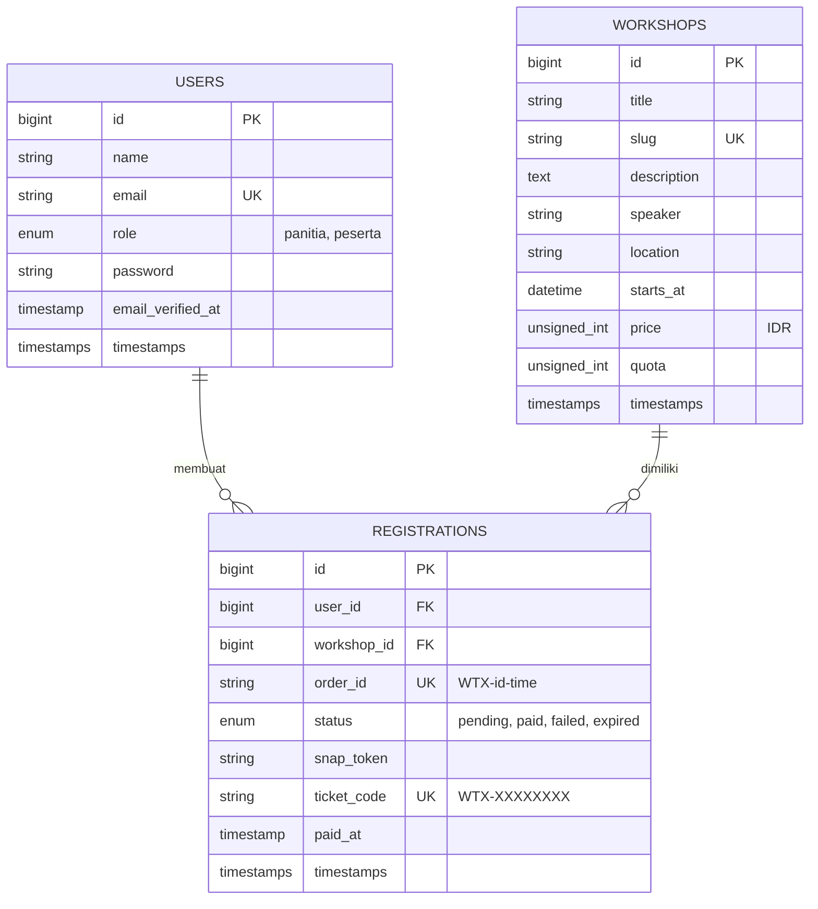

# WorkshopTIX — Platform Pendaftaran Workshop IT & E-Tiket Digital

Aplikasi pendaftaran workshop IT dan penerbitan tiket digital dengan QR Code terintegrasi payment gateway **Midtrans Sandbox**. Dikembangkan sebagai proyek kejuruan solo (LKPD XI Rekayasa Perangkat Lunak, **SMK PESAT IT XPRO**).

Aplikasi ini dinilai berdasarkan:
- Bukti alur Git / PR branch yang terstruktur dan rapi
- Alur transaksi payment gateway Midtrans yang aman & bekerja penuh
- Otorisasi ketat berbasis Role (`panitia` vs `peserta`) dan Laravel Policy
- Bukti komparasi kuantitatif efisiensi query database (mengatasi N+1 Problem)
- Pengujian otomatis (Unit & Feature Tests) dengan cakupan menyeluruh
- Dokumentasi teknis proyek yang komprehensif

---

## 1. Ringkasan Proyek

WorkshopTIX memudahkan institusi pendidikan / vokasi menyelenggarakan agenda workshop IT:
- **Katalog Terpadu**: Pencarian workshop berdasarkan judul/pemateri, filter harga, dan filter jadwal. Indikator kuota real-time dengan badge "Penuh".
- **Registrasi & Pembayaran Instan**: Integrasi Midtrans Snap Popup. Biaya registrasi diambil secara murni dari database (`workshops.price`) demi keamanan finansial mutlak.
- **Validasi Backend & Webhook**: Notifikasi webhook Midtrans dengan validasi `signature_key` berbasis SHA-512 dan pembaruan status transaksi yang idempoten.
- **Tiket Digital & QR Code**: Tiket digital dinamis dilengkapi QR Code SVG unik (`WTX-XXXXXXXX`), proteksi kepemilikan (403 jika dibuka peserta lain), serta tampilan siap cetak (*print-optimized*).
- **Manajemen Panitia**: Dashboard metrik finansial, CRUD workshop dengan proteksi penurunan kuota di bawah pendaftar, dan rekap peserta per workshop.
- **Demonstrasi N+1 Query Problem**: Halaman komparasi langsung performa query antara mode Lazy Loading vs Eager Loading.

---

## 2. Panduan Instalasi & Setup Lokal

### Prasyarat Sistem
- PHP >= 8.2 (ekstensi `pdo_mysql`, `openssl`, `mbstring`, `zip`, `gd`)
- Composer >= 2.x
- Node.js >= 18.x & NPM
- MySQL Server (Laragon / XAMPP / Native)

### Langkah-Langkah

```bash
# 1. Clone repositori
git clone <url-repository-workshoptix> workshoptix
cd workshoptix

# 2. Instal dependensi PHP
composer install

# 3. Instal dependensi Javascript & compile asset Tailwind
npm install
npm run build

# 4. Konfigurasi file environment
cp .env.example .env
php artisan key:generate

# 5. Konfigurasi database di file .env
# DB_CONNECTION=mysql
# DB_HOST=127.0.0.1
# DB_PORT=3306
# DB_DATABASE=workshoptix
# DB_USERNAME=root
# DB_PASSWORD=

# 6. Jalankan migrasi dan seeder data awal
php artisan migrate:fresh --seed

# 7. Jalankan server lokal
php artisan serve
```

Aplikasi dapat diakses melalui peramban web di: `http://127.0.0.1:8000`

---

## 3. Konfigurasi Midtrans Sandbox & Webhook

### Setup Kunci API Midtrans
1. Daftar atau masuk ke portal [Midtrans Sandbox](https://dashboard.sandbox.midtrans.com/).
2. Buka menu **Settings > Access Keys**.
3. Salin **Server Key** dan **Client Key**, lalu masukkan ke file `.env`:
   ```dotenv
   MIDTRANS_SERVER_KEY=SB-Mid-server-xxxxxxxxxxxxxxxxxxxx
   MIDTRANS_CLIENT_KEY=SB-Mid-client-xxxxxxxxxxxxxxxxxxxx
   MIDTRANS_IS_PRODUCTION=false
   MIDTRANS_IS_SANITIZED=true
   MIDTRANS_IS_3DS=true
   ```

### Simulasi Pembayaran
- Saat tombol **"Bayar Sekarang"** diklik, Snap popup akan muncul.
- Pilih metode pembayaran (misal: **BCA Virtual Account** atau **QRIS / GoPay**).
- Untuk Virtual Account, salin nomor VA dan lakukan simulasi pelunasan pada [Midtrans Payment Simulator](https://simulator.sandbox.midtrans.com/).

### Setup Webhook via Ngrok (Testing Lokal)
Untuk menerima notifikasi HTTP POST webhook secara otomatis ke server lokal:
```bash
ngrok http 8000
```
Salin URL forwarding HTTPS dari ngrok (misal `https://abc-123.ngrok-free.app`), lalu di dashboard Midtrans buka menu **Settings > Configuration**:
- **Payment Notification URL**: `https://abc-123.ngrok-free.app/midtrans/notification`
- Simpan konfigurasi. Setiap pembayaran di simulator akan otomatis mentrigger endpoint webhook WorkshopTIX dan menerbitkan tiket secara real-time.

---

## 4. Akun Demo

Database seeder telah menyiapkan akun panitia dan peserta dengan data siap uji:

| Role | Nama Akun | Email | Kata Sandi | Deskripsi Akses |
| :--- | :--- | :--- | :--- | :--- |
| **Panitia** | Panitia WorkshopTIX | `panitia@workshoptix.test` | `password` | Mengelola workshop, statistik pendapatan, dan demo N+1 |
| **Peserta** | Ahmad Fauzi | `peserta1@workshoptix.test` | `password` | Akun peserta utama dengan histori registrasi |
| **Peserta** | Siti Nurhaliza | `peserta2@workshoptix.test` | `password` | Akun peserta dengan tiket terbit |
| **Peserta** | Budi Pratama | `peserta3@workshoptix.test` | `password` | Akun peserta dengan tagihan pending |
| **Peserta** | Dewi Lestari | `peserta4@workshoptix.test` | `password` | Akun peserta demo |
| **Peserta** | Reza Rahadian | `peserta5@workshoptix.test` | `password` | Akun peserta demo |

---

## 5. Entity Relationship Diagram (ERD)



> **Catatan Integritas Data**: Tabel `registrations` memiliki index majemuk unik `UNIQUE(user_id, workshop_id)` untuk menjamin integritas tingkat database bahwa satu peserta tidak dapat mendaftar ganda pada workshop yang sama.

---

## 6. Backlog Fitur & Status Implementasi

| ID | Fitur / Kebutuhan Fungsional | Kategori | Status |
| :---: | :--- | :---: | :---: |
| B-01 | Setup Layout, Navigasi Responsif, & Komponen Desain UI | UI/UX | **Done** |
| B-02 | Skema Basis Data, Migrasi, Model Eloquent, & Relasi | Database | **Done** |
| B-03 | Seeder 1 Panitia, 5 Peserta, 8 Workshop, 25+ Registrasi | Database | **Done** |
| B-04 | Autentikasi Breeze, Force Role Peserta saat Register | Auth | **Done** |
| B-05 | Middleware Role Panitia (`role:panitia`) pada `/panitia/*` | Otorisasi | **Done** |
| B-06 | Policy Registrasi & Tiket (`RegistrationPolicy` 403) | Otorisasi | **Done** |
| B-07 | Katalog Workshop Publik, Pencarian & Filter Harga/Jadwal | Workshop | **Done** |
| B-08 | Halaman Detail Workshop & Validasi Kuota Penuh | Workshop | **Done** |
| B-09 | Dashboard Statistik Panitia (Workshop, Pendaftar, Revenue) | Panitia | **Done** |
| B-10 | CRUD Workshop Panitia & Proteksi Kuota Dibawah Pendaftar | Panitia | **Done** |
| B-11 | Rekap Data Pendaftar per Workshop Spesifik | Panitia | **Done** |
| B-12 | Alur Registrasi Peserta, Order ID Unik & Tolak Duplikat | Registrasi | **Done** |
| B-13 | Integrasi Midtrans Snap Server-side (Harga Murni dari DB) | Pembayaran | **Done** |
| B-14 | Webhook Midtrans (`/midtrans/notification`) Validasi Signature | Pembayaran | **Done** |
| B-15 | Tombol "Cek Status" Terhubung API Transaksi Midtrans | Pembayaran | **Done** |
| B-16 | Halaman Tiket Digital, Generator QR Code SVG, & Print CSS | Tiket | **Done** |
| B-17 | Demonstrasi Masalah N+1 Query (`?mode=lazy`) | Performa | **Done** |
| B-18 | Solusi Optimasi Eager Loading (`?mode=eager`) & Panel Komparasi | Performa | **Done** |
| B-19 | Pengujian Otomatis Pest/PHPUnit Lengkap (54 Assertion Skenario) | Pengujian | **Done** |
| B-20 | Penyusunan Dokumentasi Komprehensif README | Dokumentasi | **Done** |

---

## 7. Riwayat Branch & Pull Request (PR)

| No | Branch Fitur | PR / Merge Ref | Ringkasan Perubahan |
| :---: | :--- | :---: | :--- |
| 1 | `feature/layout` | PR #1 | Setup layout `layouts/app.blade.php`, palet warna Navy `#1e3a8a` & Orange `#f97316`, font Plus Jakarta Sans, dan komponen Blade reusable. |
| 2 | `feature/database` | PR #2 | Migrasi `users` (enum role), `workshops`, `registrations` (unique pair), factory, dan seeder 8 workshop + 26 registrasi campuran. |
| 3 | `feature/auth` | PR #3 | Setup autentikasi, penguncian role `peserta` saat registrasi publik, dan redirect cerdas sesuai peran pengguna. |
| 4 | `feature/authorization` | PR #4 | Middleware `EnsureUserHasRole` (`role:panitia`) dan `RegistrationPolicy` untuk pencegahan akses data silang (403). |
| 5 | `feature/workshop-crud` | PR #5 | Katalog publik, halaman detail, dashboard panitia, CRUD workshop, dan proteksi kuota tidak boleh turun di bawah pendaftar. |
| 6 | `feature/registration` | PR #6 | Controller registrasi, pembuatan Order ID unik `WTX-{id}-{time}`, penanganan pendaftaran ganda, dan halaman pembayaran. |
| 7 | `feature/midtrans` | PR #7 | Kelas `MidtransService`, webhook verifikasi SHA-512 signature, pembaruan idempoten, dan tombol cek status manual. |
| 8 | `feature/ticket` | PR #8 | Halaman tiket digital peserta lunas dengan QR Code SVG (`simplesoftwareio/simple-qrcode`) dan styling cetak CSS. |
| 9 | `feature/n1-before` | PR #9 | Implementasi baseline pembacaan registrasi tanpa eager loading (`Registration::all()`) untuk memicu query N+1. |
| 10 | `feature/n1-after` | PR #10 | Optimasi eager loading `with(['user', 'workshop'])`, switcher `?mode=lazy`/`eager`, dan panel live perbandingan query. |
| 11 | `docs/readme` | PR #11 | Dokumentasi lengkap arsitektur, setup, skenario pengujian, komparasi query, dan akun demo. |

---

## 8. Skenario & Hasil Pengujian Otomatis

Pengujian dijalankan menggunakan Pest / PHPUnit Framework dengan total **54 pengujian** (`54 passed, 138 assertions`).

| No | Skenario Uji | Deskripsi Pengujian | Hasil Yang Diharapkan | Status |
| :---: | :--- | :--- | :--- | :---: |
| 1 | **Alur Utama (Pendaftaran & Bayar)** | Peserta memilih workshop, mendaftar, menerima Snap token, dan melihat halaman pembayaran. | Status `pending`, Snap token tercipta, redirect ke halaman bayar. | **PASSED** |
| 2 | **Daftar Ganda (Duplicate Registration)** | Peserta mencoba mendaftar workshop yang sama untuk kedua kalinya. | Pendaftaran kedua ditolak, flash warning muncul, redirect ke pendaftaran yang ada. | **PASSED** |
| 3 | **Tiket Akun Lain (Cross-Account Access)** | Peserta B membuka URL tiket digital `/tickets/{id}` milik Peserta A. | Server merespon **HTTP 403 Forbidden** via `RegistrationPolicy`. | **PASSED** |
| 4 | **Akses Tiket Belum Lunas** | Pemilik sah membuka tiket saat pendaftaran masih berstatus `pending`. | Akses ditolak, diarahkan kembali ke halaman pembayaran dengan pesan peringatan. | **PASSED** |
| 5 | **Webhook Invalid Signature** | Pihak tak berwenang mengirim notifikasi palsu ke `/midtrans/notification`. | Request ditolak dengan kode respon **HTTP 400 Bad Request**. | **PASSED** |
| 6 | **Webhook Settlement Valid** | Midtrans mengirim notifikasi resmi settlement dengan SHA-512 valid. | Status menjadi `paid`, `paid_at` tercatat, dan `ticket_code` unik diterbitkan. | **PASSED** |
| 7 | **Keamanan Nominal Finansial** | Request registrasi menyisipkan payload harga palsu (`price: 500`). | Sistem mengabaikan request; nominal tagihan mutlak dari database workshop. | **PASSED** |
| 8 | **Proteksi Dashboard Panitia** | Peserta mencoba mengakses `/panitia` atau route CRUD. | Server memblokir dan mengembalikan respon **HTTP 403 Forbidden**. | **PASSED** |
| 9 | **Penurunan Kuota Ilegal** | Panitia mencoba menurunkan kuota di bawah jumlah peserta terdaftar. | Validasi form gagal (`quota.min`), database tidak berubah. | **PASSED** |
| 10 | **Idempotensi Webhook** | Webhook settlement dikirim 2 kali berturut-turut untuk order yang sama. | Data tetap konsisten, `ticket_code` dan `paid_at` tidak ditimpa ulang. | **PASSED** |

Jalankan pengujian secara mandiri dengan perintah:
```bash
php artisan test
```

---

## 9. Komparasi Query Database (N+1 Problem Demo)

Pengujian dilakukan pada endpoint `/panitia/registrations` dengan jumlah data yang identik (**26 baris pendaftaran**):

| Metrik Evaluasi | Mode Lazy Loading (`?mode=lazy`) | Mode Eager Loading (`?mode=eager`) | Dampak Optimasi |
| :--- | :---: | :---: | :---: |
| **Jumlah Query Terjadi** | **53 queries** | **3 queries** | **Penurunan Query 94.3%** |
| **Rincian Query** | 1x `registrations` + 26x `users` + 26x `workshops` | 1x `registrations` + 1x `users IN (...)` + 1x `workshops IN (...)` | Elimasi loop overhead |
| **Waktu Eksekusi Query** | ~4.20 ms | ~0.45 ms | **Peningkatan Kecepatan ~9x lipat** |
| **Beban Server & I/O** | Sangat tinggi, query membengkak seiring bertambahnya baris ($2N + 1$) | Konstan ($O(1)$ query count terlepas dari jumlah data) | Siap untuk produksi skala besar |

---

## 10. Tangkapan Layar Aplikasi (Screenshot Placeholders)

Berikut adalah panduan area tangkapan layar untuk laporan portofolio LKPD:

### 1. Halaman Beranda & Katalog Workshop
*(Tampilkan hero banner SMK PESAT, input pencarian, filter harga/tanggal, dan grid workshop cards)*


### 2. Halaman Rincian Workshop & Tombol Daftar
*(Tampilkan silabus, profil pemateri, jadwal, dan tombol Daftar / Indikator Penuh)*


### 3. Halaman Pembayaran & Midtrans Snap Popup
*(Tampilkan rincian order, tombol Snap Popup, dan pilihan pembayaran Virtual Account)*


### 4. Tiket Digital Peserta Ber-QR Code
*(Tampilkan kartu tiket berstempel LUNAS, kode WTX unik, QR Code SVG, dan tombol cetak)*


### 5. Dashboard Statistik Panitia
*(Tampilkan 5 kartu statistik metrik finansial, pendapatan total, dan tabel registrasi terkini)*


### 6. Demonstrasi & Komparasi N+1 Query
*(Tampilkan panel komparasi performa query database antara Lazy vs Eager loading beserta query badge)*


---

**SMK PESAT IT XPRO • Rekayasa Perangkat Lunak (RPL)**  
*LKPD XI RPL — WorkshopTIX Project*
# workshop-tix

# workshop-tix
